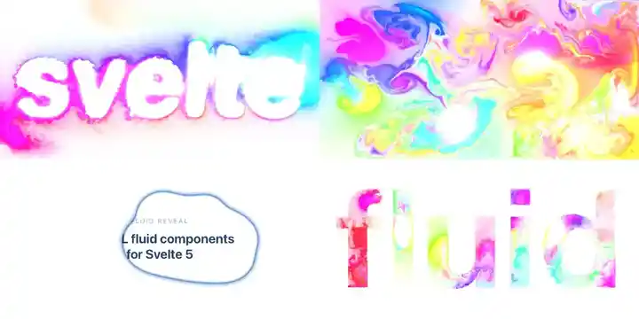

[](https://github.com/tommyyzhao/svelte-fluid/actions/workflows/ci.yml)
[](https://www.npmjs.com/package/svelte-fluid)
[](https://www.npmjs.com/package/svelte-fluid)
[](https://packagephobia.com/result?p=svelte-fluid)
[](LICENSE)

# svelte-fluid

Fluid simulation for Svelte 5.

<p align="center">
  
</p>

<p align="center">
  <strong><a href="https://svelte-fluid.dev/">Live demo</a></strong>
</p>

### Why svelte-fluid?

Most fluid packages are vanilla JS with a Svelte wrapper bolted on.
This one is built for Svelte 5 from the ground up:

- **True component API** — `<Fluid />` with 70+ typed props, live reactive updates, and full cleanup on unmount
- **Many independent canvases on one shared WebGPU device** — warm WGSL pipelines, isolated fields and input
- **State-preserving resize** — live dye and velocity survive layout changes without pipeline recompilation
- **14 example presets** — reference configurations showing the range of what's possible
- **5 container shapes** — circle, frame, roundedRect, annulus, and arbitrary SVG paths / text via mask texture
- **Glass post-processing** — refraction, specular highlights, and chromatic aberration on any container shape
- **Lazy loading + auto-pause** — defer engine creation until viewport entry
- **Imperative API** — `splat()` and `randomSplats()` via `bind:this`

## Install

```sh
npm install svelte-fluid
# or
pnpm add svelte-fluid
# or
bun add svelte-fluid
```

> Requires Svelte ≥ 5.

## Quick start

```svelte
<script lang="ts">
  import { Fluid } from 'svelte-fluid';
</script>

<div style="width:100%; height:100vh">
  <Fluid />
</div>
```

That's it. Canvas fills its parent, resize handled automatically.

For a first-run screen that shows motion immediately in a blank app,
start with a slightly brighter starter config:

```svelte
<div style="width:100%; height:100vh">
  <Fluid
    seed={42}
    initialSplatCount={20}
    autoSplatRate={0.25}
    autoSplatCount={2}
    densityDissipation={0.35}
    velocityDissipation={0.08}
    curl={45}
    splatRadius={0.35}
    bloomIntensity={1.2}
    sunraysWeight={0.6}
    backColor={{ r: 6, g: 10, b: 26 }}
  />
</div>
```

### Fixed dimensions

```svelte
<Fluid width={400} height={300} />
```

### Custom physics

```svelte
<Fluid
  curl={20}
  splatRadius={0.5}
  bloom={false}
  shading
  densityDissipation={0.4}
  initialSplatCount={12}
  seed={42}
/>
```

### Imperative API via `bind:this`

```svelte
<script lang="ts">
  import { Fluid, type FluidHandle } from 'svelte-fluid';

  let ref = $state<{ handle: FluidHandle } | undefined>();
</script>

<button onclick={() => ref?.handle.randomSplats(10)}>Splat!</button>
<Fluid bind:this={ref} />
```

## Experimental material treatments

On the R&D branch, three small treatments compose with your own HTML. They are
not replacements for links, buttons, headings, or application state. No new
runtime dependencies; no change to the fluid solver.

```svelte
<script lang="ts">
  import { MaterialEnamel, MaterialFoil, MaterialImage } from 'svelte-fluid';
  let dark = $state(false);
</script>

<h1><MaterialEnamel text="Made to be felt." /></h1>

<button type="button" role="switch" aria-label="Dark appearance"
  aria-checked={dark} onclick={() => dark = !dark}>
  <MaterialFoil selected={dark} />
  Dark appearance: {dark ? 'On' : 'Off'}
</button>

<a href="/journal/arles">
  <MaterialImage src="/arles.jpg" alt="Sunlit arches in Arles"
    width={3803} height={3162} />
</a>
```

Your application applies the selected theme. Foil observes the boolean; it never
toggles it. The entire enclosing button/link owns input, focus and activation.
Canvases do not capture pointers or cancel scrolling. Enamel keeps the actual
text and a stationary outline; image motion never hides the source or gates a link.

| Treatment | Required props | Intended role |
| --- | --- | --- |
| `MaterialEnamel` | `text: string` | Molded enamel on short display text. Inherits font, color and wrapping from its parent. |
| `MaterialFoil` | `selected: boolean` | A 6rem × 3rem decorative snap mechanism inside an existing binary control. |
| `MaterialImage` | `src`, `alt`, positive `width`, `height` | Local retained distortion over an explicit image. Dimensions reserve its aspect ratio. Cross-origin sources require CORS. |

All three accept `enabled` (default `true`), `class`, and
`onStatus(status: MaterialStatus)`. Status is `loading`, `ready`, `static`, or
`unavailable`, with an optional `reason`. `bind:this` exposes `retry()`; show local
recovery when it is useful. Callback exceptions are isolated. `enabled={false}`
releases resources and retains the ordinary text/image/vector finish.

Reduced motion uses still finishes and immediate selected-state changes.
Forced colors uses native content and a vector foil. Initialization/asset/device
failure cannot disable the host control. Text/image content exists before startup.
No endless ambient animation: resting, hidden and offscreen treatments stop drawing.

Presentation uses actual fractional CSS dimensions × DPR, including 3×, without
a quality cap. Model density is independent. Sources, mips, profiles and local
outputs have explicit native-size limits; unsupported sizes retain plain content
instead of being silently blurred. Large original images still cost memory.

Current enamel support is **plain, horizontal, untransformed display text** (up
to 2048 UTF-16 code units), not arbitrary styled DOM capture. Font/text/reflow
changes rebuild its relief; DPR-only updates preserve the physical fields and
color-only updates do not allocate GPU resources. New geometry resets transient
deformation. Use `retry()` after external stylesheet changes that do not change
observed geometry/classes; native text remains authoritative.

These are illustrative material models, not calibrated metal/liquid physics.
The image uses bounded invertible coordinate maps, not a full fluid solve.
Phone energy/thermal performance and broad assistive-technology coverage are
not yet established. The simplified composition at `/lab/interfaces/library`
uses only the foil appearance switch; **Plain** comparison is in Study notes.
The enamel and image treatments remain available separately, not stacked on that page.

## Browser compatibility

svelte-fluid requires WebGPU in a secure context (`https:` or localhost) and a
usable adapter. Current Chromium-family browsers and Safari 26+ provide WebGPU;
Firefox availability still depends on release/platform. Capability—not user-agent
version—is the contract:

```ts
import { isFluidGpuAvailable } from 'svelte-fluid';

if (await isFluidGpuAvailable()) {
  // mount the interactive experience
}
```

`<Fluid>` degrades without crashing: provide a `fallback` snippet or `poster`, or
it renders an accessible `backColor` fill. Set `requireHardwareAcceleration` to
reject a software/fallback adapter. There is no WebGL backend.

## Props

All props are optional and use camelCase.

| Prop | Type | Default | Notes |
| --- | --- | --- | --- |
| `width` | `number` | — | CSS px. Omit to fill parent. |
| `height` | `number` | — | CSS px. Omit to fill parent. |
| `maxPixelRatio` | `number \| null` | `2` | cap physical DPR; pass `null` for native DPR |
| `seed` | `number` | random | 32-bit uint; deterministic initial splats |
| `simResolution` | `number` | `128` | velocity grid; guarded field-graph rebuild |
| `dyeResolution` | `number` | `1024` | dye grid; guarded field-graph rebuild |
| `densityDissipation` | `number` | `1` | hot; **steady-state** value |
| `initialDensityDissipation` | `number` | (= `densityDissipation`) | hot; ramp start (see [burn-in pattern](#burn-in-density-dissipation)) |
| `initialDensityDissipationDuration` | `number` | `0` | seconds; duration of the linear ramp |
| `velocityDissipation` | `number` | `0.2` | hot |
| `pressure` | `number` | `0.8` | hot |
| `pressureIterations` | `number` | `20` | hot |
| `autoPerformance` | `boolean` | `false` | hot; sustained-load quality governor |
| `autoPerformanceTargetFrameMs` | `number` | `1000 / 60` | hot; live-frame budget for the governor |
| `curl` | `number` | `30` | vorticity confinement; hot |
| `splatRadius` | `number` | `0.25` | hot |
| `splatForce` | `number` | `6000` | hot |
| `shading` | `boolean` | `true` | hot presentation toggle |
| `colorful` | `boolean` | `true` | hot; rotate pointer/touch splat colors over time |
| `colorUpdateSpeed` | `number` | `10` | hot; pointer/touch color rotation rate |
| `paused` | `boolean` | `false` | hot |
| `backColor` | `{r,g,b}` | `{0,0,0}` | 0–255 RGB; hot |
| `transparent` | `boolean` | `false` | hot |
| `bloom` | `boolean` | `true` | allocates/releases bloom targets |
| `bloomIterations` | `number` | `8` | hot pass count |
| `bloomResolution` | `number` | `256` | rebuilds bloom targets |
| `bloomIntensity` | `number` | `0.8` | hot |
| `bloomThreshold` | `number` | `0.6` | hot |
| `bloomSoftKnee` | `number` | `0.7` | hot |
| `sunrays` | `boolean` | `true` | allocates/releases sunrays target |
| `sunraysResolution` | `number` | `196` | rebuilds sunrays target |
| `sunraysWeight` | `number` | `1` | hot |
| `initialSplatCount` | `number` | — | exact count for the first frame |
| `initialSplatCountMin` | `number` | `5` | min of random range |
| `initialSplatCountMax` | `number` | `25` | max of random range |
| `autoSplatRate` | `number` | `0` | automatic burst rate in splats/sec; 0 = disabled |
| `autoSplatCount` | `number` | `1` | number of splats emitted each burst |
| `autoSplatColor` | `{r,g,b}` | `null` | fixed color for automatic splats; null = fresh random color per splat |
| `autoSplatVelocityX` | `number` | `0` | x velocity for automatic splats; ignored when `autoSplatSwirl` is nonzero |
| `autoSplatVelocityY` | `number` | `0` | y velocity for automatic splats; negative moves downward in DOM space |
| `autoSplatCenterY` | `number` | `0.5` | vertical center of the spawn band: 0 = bottom, 0.5 = center, 1 = top |
| `autoSplatEvenX` | `boolean` | `false` | within each burst, use equal x positions instead of random x positions |
| `autoSplatSwirl` | `number` | `0` | orbital velocity around the container/canvas center; positive = CCW |
| `autoSplatBandHeight` | `number` | `0.1` | height of the spawn band; 0 = single line, 0.1 = ±5%, 2.0 = full canvas |
| `pointerInput` | `boolean` | `true` | hot; toggles canvas + window listeners |
| `splatOnHover` | `boolean` | `false` | hot; splat on mousemove without click |
| `containerShape` | `ContainerShape` | `null` | confine fluid to a shape; see [Container shapes](#container-shapes) |
| `glass` | `boolean` | `false` | glass post-processing; requires `containerShape`; see [Glass effect](#glass-effect) |
| `glassThickness` | `number` | `0.04` | glass wall width in UV units (rim model only) |
| `glassRefraction` | `number` | `0.4` | refraction strength 0–1; mapped to IOR 1.0–2.0 |
| `glassReflectivity` | `number` | `0.12` | specular intensity (Fresnel F0) 0–1 |
| `glassChromatic` | `number` | `0.15` | chromatic aberration strength 0–1 |
| `presetSplats` | `PresetSplat[]` | — | construct-only; declarative initial scene (see [Presets](#presets)) |
| `lazy` | `boolean` | `false` | construct-only; defer engine creation until container enters viewport |
| `autoPause` | `boolean` | `true` | pause when not visible (IntersectionObserver + visibilitychange) |

The component also forwards any standard `<canvas>` attributes
(`class`, `style`, `aria-label`, …) onto the underlying canvas via
`...rest`.

## Presets

Fourteen reference configurations demonstrating different physics setups,
container shapes, and solver-native flow scenes. Useful as starting points for building your own:

| Component | Look |
| --- | --- |
| `<LavaLamp />` | Warm blobs in a glass vessel with rim refraction |
| `<Plasma />` | Plasma-inspired visual fluid with full-spectrum jets converging into a bright core |
| `<InkInWater />` | India ink sinking through dark water with volumetric bloom |
| `<FrozenSwirl />` | An icy whirlpool frozen inside a circular vessel |
| `<Aurora />` | Green, magenta, and pale-blue ribbons glowing like northern lights |
| `<Toroidal />` | Full-spectrum storm circulating in a high-velocity ring |
| `<CircularFluid />` | Vivid swirling fluid contained inside a circle |
| `<FrameFluid />` | Colorful fluid swirling around a rectangular inner cutout |
| `<AnnularFluid />` | Ring-vortex fluid between two concentric circles |
| `<SvgPathFluid />` | Fluid shaped by an ampersand glyph via mask texture |
| `<GasFlare />` | Temperature scalar, buoyancy, and physical nozzle obstructions |
| `<Venturi />` | Pressure-gradient throughflow with CFD-style speed visualization |
| `<Karman />` | Alternating cylinder-wake vortex street with multicolor tracers |
| `<TeslaValve />` | High-viscosity multicolor splats through an SVG conduit mask |

```svelte
<script lang="ts">
  import { LavaLamp, Plasma, Toroidal } from 'svelte-fluid';
</script>

<div style="height: 100vh">
  <LavaLamp />
</div>

<div style="display:grid; grid-template-columns:repeat(2, 1fr); gap:16px">
  <Plasma />
  <Toroidal />
</div>
```

Each preset forwards a small common set of props: `width`, `height`,
`class`, `style`, `seed`, `lazy`, `maxPixelRatio`, `splatOnHover`, `aria-label`, and
`backColor`. Flow-scene presets also expose `pointerInput`, and some shape
presets expose small shape-specific knobs such as corner radii. The main
physics recipe is intentionally fixed. They all re-expose the imperative
`handle` so you can still call `splat()` / `randomSplats()` from outside via
`bind:this`.

### Building your own preset

A preset is a tiny wrapper around `<Fluid />` that pins config and
optionally passes a `presetSplats` array. The engine consumes
`presetSplats` once at construction (right after the random initial
splats), so the opening scene is fully deterministic and reproducible
across resizes.

```svelte
<script lang="ts">
  import { Fluid, type PresetSplat, type FluidHandle } from 'svelte-fluid';

  const SPLATS: PresetSplat[] = [
    { x: 0.5, y: 0.1, dx: 0, dy: 800, color: { r: 1.6, g: 0.4, b: 0.1 } }
  ];

  let inner = $state<{ handle: FluidHandle } | undefined>();
  export const handle: FluidHandle = {
    splat: (x, y, dx, dy, c) => inner?.handle.splat(x, y, dx, dy, c),
    randomSplats: (n) => inner?.handle.randomSplats(n)
  };
</script>

<Fluid
  bind:this={inner}
  curl={50}
  densityDissipation={0}
  initialSplatCount={0}
  presetSplats={SPLATS}
/>
```

Note: `presetSplats` is **construct-only** — like `seed`, changes after
mount are ignored. To paint a new scene, change the `seed` (which forces
a teardown/rebuild) or call `handle.splat()` imperatively.

Splat coordinates are normalized: `x ∈ [0,1]` left-to-right and
`y ∈ [0,1]` **bottom-to-top**. Color components are in 0–1 range; values
above 1 are valid and read as HDR highlights through the bloom pass.

## Burn-in density dissipation

If you want a `densityDissipation: 0` "vivid persistent" look but the
opening splats are bright enough to overwhelm the canvas, use a
temporary high dissipation that decays to zero:

```svelte
<Fluid
  densityDissipation={0}
  initialDensityDissipation={1.5}
  initialDensityDissipationDuration={2}
  presetSplats={SPLATS}
/>
```

The engine linearly interpolates from `initialDensityDissipation` →
`densityDissipation` over `initialDensityDissipationDuration` seconds,
then holds at the steady-state value forever. This lets the overlapping
additive splats "burn in" — overbright pixels fade for the first couple
of seconds — before dissipation locks at zero so the remaining dye
persists indefinitely. The `LavaLamp` and `Plasma` presets
use this pattern.

The clock starts when the engine begins ticking (post-mount, post
first ResizeObserver fire), so the burn-in survives `setConfig`
updates and matches the user's perception of "since the canvas
appeared".

## Container shapes

Confine the fluid to a geometric region with `containerShape`. The
simulation physically enforces the boundary — velocity is zeroed outside
and dye is masked after advection.

```svelte
<!-- Circle -->
<Fluid containerShape={{ type: 'circle', cx: 0.5, cy: 0.5, radius: 0.45 }} />

<!-- Frame (fluid fills the border region around a rectangular cutout) -->
<Fluid containerShape={{ type: 'frame', cx: 0.5, cy: 0.5, halfW: 0.25, halfH: 0.25 }} />

<!-- Rounded rectangle -->
<Fluid containerShape={{ type: 'roundedRect', cx: 0.5, cy: 0.5, halfW: 0.35, halfH: 0.25, cornerRadius: 0.05 }} />

<!-- Annulus (ring between two circles) -->
<Fluid containerShape={{ type: 'annulus', cx: 0.5, cy: 0.5, innerRadius: 0.15, outerRadius: 0.4 }} />

<!-- SVG path -->
<Fluid containerShape={{ type: 'svgPath', d: 'M50 5 L61 40 L98 40 L68 62 L79 97 L50 75 L21 97 L32 62 L2 40 L39 40 Z' }} />

<!-- Text (fluid-filled letters) -->
<Fluid containerShape={{ type: 'svgPath', text: 'HELLO', font: 'bold 72px sans-serif' }} />
```

Coordinates are normalized: `cx`/`cy` in [0, 1] (left-to-right,
bottom-to-top). `radius` is normalized by canvas height. The `svgPath`
type rasterizes to a mask texture via `OffscreenCanvas` and supports
both SVG path data (`d`) and Canvas 2D text (`text`).

## Glass effect

Add a glass post-processing layer to any container shape with `glass`.
Circles get a hemisphere dome with Snell's law refraction; all other
shapes get rim refraction at the boundary.

```svelte
<!-- Glass orb with chromatic aberration -->
<Fluid
  containerShape={{ type: 'circle', cx: 0.5, cy: 0.5, radius: 0.4 }}
  glass
  glassRefraction={0.6}
  glassChromatic={0.3}
/>

<!-- Subtle glass frame -->
<Fluid
  containerShape={{ type: 'frame', cx: 0.5, cy: 0.5, halfW: 0.3, halfH: 0.2 }}
  glass
  glassThickness={0.06}
  glassReflectivity={0.08}
/>
```

The specular highlight tracks the mouse cursor automatically. All
highlights are driven by the fluid brightness — no fluid, no highlights.

## FluidBackground composition

`FluidBackground` is a page or screen wrapper, not a local card widget.
Its fluid canvas is fixed to the viewport, and its slotted content sits
above the canvas with `pointer-events: none` so window-level pointer
input keeps feeding the simulation.

Keep elements inside the slot when they should carve holes in the fluid
via `exclude`. Add `pointer-events: auto` back to interactive children
such as nav bars, cards, and forms:

```svelte
<script lang="ts">
  import { FluidBackground } from 'svelte-fluid';
</script>

<FluidBackground class="fluid-screen" exclude=".site-nav, .panel" splatOnHover>
  <nav class="site-nav">...</nav>
  <main class="hero-copy">...</main>
  <section class="panel">...</section>
</FluidBackground>

<style>
  :global(.fluid-screen) {
    min-height: 100vh;
    isolation: isolate;
  }

  .site-nav,
  .panel {
    position: relative;
    z-index: 2;
    pointer-events: auto;
  }

  .hero-copy {
    position: relative;
    z-index: 1;
  }
</style>
```

For a local bounded canvas, use `<Fluid />` with a parent size or fixed
`width` / `height` instead.

## Resize behavior

On resize, the engine keeps its WebGPU device and compiled pipelines. When field
extents change it builds replacements off-side and resamples live dye, velocity,
and pressure. Synchronous validation/allocation failures retain the old graph;
asynchronous driver validation or OOM failures are scoped to that instance and
surface its fallback. CSS/DPR changes whose computed extents stay the same only
reconfigure the canvas. Physical DPR is capped at 2 by default; pass
`maxPixelRatio={null}` to use native DPR.

Structural config/resize bursts are coalesced behind at most one in-flight GPU
transition. Scalar channel-order changes preserve velocity, dye, and pressure but
clear scalar state so existing values cannot silently acquire new meanings.

## Multiple instances

All `<Fluid />` instances share one `GPUDevice`, exact-source WGSL module/pipeline
cache, and RAF scheduler. Each canvas retains independent textures, uniforms,
listeners, pointer state, and simulation state.

For dense pages, pass `lazy={true}`. The component defers its per-instance field
allocation until viewport entry and releases those fields when it leaves; the
shared device and compiled graph stay warm:

```svelte
<LavaLamp lazy />
<Plasma lazy />
```

`autoPause` is lighter: it stops work while keeping that instance's fields alive.

## Programmatic engine

Not using the Svelte component? The raw engine works standalone:

```ts
import { FluidEngine } from 'svelte-fluid';

const canvas = document.querySelector('canvas')!;
canvas.width = canvas.clientWidth * devicePixelRatio;
canvas.height = canvas.clientHeight * devicePixelRatio;

const engine = new FluidEngine({
  canvas,
  config: { curl: 20, bloom: false, seed: 42 }
});

await engine.ready;

// later…
engine.splat(0.5, 0.5, 100, 0, { r: 1, g: 0.5, b: 0 });
engine.randomSplats(8);
engine.setConfig({ curl: 5 });
engine.dispose();
```

## Development

This project uses **bun**.

```sh
bun install
bun run dev      # demo playground at http://localhost:5173
bun run check    # svelte-check
bun run package  # produces dist/ with svelte-package
bun run build    # builds the SvelteKit demo site
```

## Contributing

See [CONTRIBUTING.md](CONTRIBUTING.md) for local setup, architecture
rules, and common workflows. Please open an issue before starting large
changes.

## Acknowledgments

Derived from [PavelDoGreat/WebGL-Fluid-Simulation](https://github.com/PavelDoGreat/WebGL-Fluid-Simulation),
Pavel Dobryakov's iconic 2017 fluid sim. The equations and visual intent were
ported to a native WGSL/WebGPU engine; both works are MIT-licensed.

The reveal and distortion effects were inspired by
[Ksenia Kondrashova's](https://codepen.io/ksenia-k) creative WebGL
demos built on the same fluid simulation.
